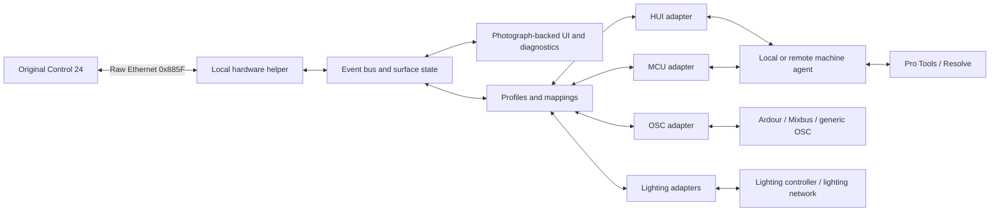

# Control|24 Lab implementation plan

Research baseline: 6 November 2026. Scope: the original Digidesign Control|24 only.

## Product and architecture

One local bridge owns the console. Independent destination adapters translate normalized control events to application commands and translate application feedback to surface state. A profile contains a destination machine, adapter, mappings, banks/layers, encoder behavior, and a feedback policy. DAW-specific behavior does not belong in the Ethernet decoder.

A browser cannot access raw Ethernet. The initial Python/HTML workbench is retained as a development prototype. Following the user's request for Swift, the native application now uses SwiftUI/AppKit and a Swift protocol/routing core, with no embedded browser or Python process. The next hardware milestone still needs a minimal separately privileged BPF helper. Keep the normal application unprivileged.

For another machine on the network, keep the desk owner on its Ethernet segment. OSC can target a reachable remote host directly. HUI/MCU require MIDI endpoints on the DAW machine: implement a remote agent carrying structured events/feedback over an authenticated connection, or support an explicitly configured network MIDI session. A profile hostname/IP is not sufficient to implement network HUI. Do not tunnel raw console ownership independently from each DAW.

## Milestones and acceptance

| Milestone | Deliverable | Completion evidence |
| --- | --- | --- |
| 1 · Workbench | Photo view, simulated input, catalog, byte previews, event log, profile persistence, basic OSC routing | Implemented now; automated tests plus browser checks. All hardware remains unverified. |
| 2 · Complete inventory | Audit the manufacturer guide against both repositories and the actual desk; position every digital control in the image; identify analog/local-only controls | Every physical control has a stable ID, image region, input/output capabilities, source, and verified or explicitly unresolved status. |
| 3 · Hardware session | Discovery, MAC/interface selection, ownership, handshake, sequence/ACK tracking, keepalive, reconnect and orderly disconnect | Captures of connect/disconnect/reconnect; stable operation through simultaneous 24-fader movement and display updates; no silent packet loss. |
| 4 · Bidirectional surface | Physical button/encoder input; motor, LED, ring, meter, scribble and counter output | Per-control fixture captures and a guided hardware verification report; touch prevents conflicting motor updates; unknown packets retained. |
| 5 · DAW adapters | Pro Tools HUI, Ardour OSC setup/feedback negotiation, Mixbus validation, remote agent | End-to-end operation on named software versions and machines; banks, touch, automation and feedback verified. |
| 6 · Desk profile selection | Reserved chord opens a profile chooser; scribbles label choices; encoder or function keys select; cancel/timeout | Target change releases old held controls, ends touches, drops old queues, obtains new state and then re-enables output. |
| 7 · Resolve / lighting | MCU capability matrix for installed Resolve; Lighting mappings; Art-Net/sACN if needed | Tests on the installed Resolve release and the actual venue controller. Unavailable features shown explicitly. |
| 8 · Package and harden | Signed app, small hardware helper, remote authentication, bounded logs/queues, diagnostics export | Install on a clean machine; recover from unplug, DAW crash, network loss, restart and malformed traffic. |

The current app uses Shift+Option+F1–F6 for profile selection, leaving ordinary function keys assignable. It remains a prototype chord until tested on the physical desk. Hardware identity comes from the bridge and is never redefined by a profile.

## Visual surface

Use a real image of the original unit, with a stable coordinate system and separate masks for faders, buttons, encoders, displays and meters. Preserve the seated reference for the first version; add an overhead view using an appropriately licensed photograph or a new photograph of this desk. Do not generate small panel labels with AI: control accuracy requires real references and manual alignment.

The current image is a historical product-style photograph from the reference repository. Approximate hotspots cover channel strips, a subset of navigation, the counter and transport; other controls are operable from the inspector. Simulated function keys are also available separately. The native and browser surfaces now use independent homographies for the upper and lower panels: footprints, fader lanes/caps and inverse dragging follow panel perspective. Shared panel/fader calibration is in `data/surface-geometry.json`. Individual coordinates and masks still require a complete image audit; browser point calibration does not calibrate full fader geometry.

Finish the visual layer by replacing photographed caps/illumination with calibrated neutral masks, then render live fader caps, button states, encoder positions/ring patterns, per-segment meters, scribbles and counter points. The current static illuminated photograph cannot truthfully stand in for live meters or LED states. Its animated overlays are deliberately separate and the interface calls out the limitation. Add zoom and close inspection once all coordinates are validated.

Separate these states: physical button down, requested command state, DAW-confirmed state, and actual hardware output requested/acknowledged. Do not assume pressing Mute means the target has accepted mute. Physical LED readback may not be available; “LED on” can mean a commanded output rather than a measured lamp.

## Hardware and reverse engineering

Maintain one reproducible evidence record per control: stable physical ID; panel label/location; native address; press/release bytes; encoder signed delta and acceleration; range/resolution; LED address/color/blink behavior; display width/charset/segments; source revision; capture references; verified firmware/version; and uncertainty.

Audit channel-strip expansion rather than assuming every section-zero address repeats identically. Some upstream labels are unknown, two encoder map entries are ambiguous, and additional monitor LEDs do not necessarily imply matching digital input buttons. The analog inventory in milestone 1 is a set of candidates, including switch-group placeholders; it is not an assertion that every preamp gain, phantom switch, monitor knob, or submixer control emits Ethernet.

Capture a known working session first. Record every control individually in press/release pairs, fader touch without motion, fader travel, encoder motion in both directions and at several speeds, jog/shuttle modes, simultaneous modifiers, and edge cases. Capture host-to-desk output independently to identify lamps, ring patterns, meter segments, automation indicators, scribble alphabets and counter modes/decimal points. Compare firmware versions if behavior differs.

The hardware helper needs a dedicated connection state machine and one serialized writer. Keep ACK/keepalive scheduling separate from slower display updates. Batch/coalesce display and meter updates; preserve button edges and touch transitions. Guard reconnect/profile changes with generations so stale motor/display commands cannot reach a new session. Add sequence wrap, duplicate suppression and retransmission behavior from packet evidence, not assumptions.

## Adapter decisions

- **Pro Tools:** implement three eight-strip HUI ports as the starting route for the 24 strips, with input/output heartbeat, two-way faders/touch, pan, mute/solo/record, banks, automation, names, counters and meters. Use Engine Renewed as evidence. Pro Tools scripting can supplement supported actions after capability inspection; it is not assumed to replace the mixing control protocol. Validate MIDI port configuration and channel banking in the installed release.
- **Ardour:** native OSC is the first end-to-end target. Add `/set_surface` negotiation, 24-strip banking, subscriptions, positional faders, encoder accumulation/limits and transport feedback. The current basic route maps faders, channel mute/solo/record-enable and transport; encoder events are logged but have no pan mapping yet. Add selective channel automation and plugin pages after feedback is reliable.
- **Mixbus:** begin with OSC but verify its own version and supported operations. Maintain an adapter capability table and separate target profiles, rather than equating every Ardour command with every Mixbus feature.
- **Resolve/Fairlight:** investigate third-party MCU support in the installed Resolve manual and test bank/extension limits, available faders, pan and feedback. Do not promise 24 simultaneous channels or comprehensive mixer control through its scripting API. Resolve's Fairlight page and the separate Fairlight Live product are different targets.
- **Lighting:** inspect the existing controller's API/patch before defining commands. A venue profile should map meaningful actions—look, cue, intensity, effect, blackout—to known OSC/HTTP/DMX capabilities. Define feedback and pickup semantics per mapping. Add Art-Net or sACN only if the rig needs direct DMX; persist universe/channel/fixture assignments and keep them separate from DAW profiles.

## Routing and handover

Profiles identify both software and a machine: “Pro Tools · Studio A” and “Pro Tools · Studio B” are separate. Only one active destination owns the desk in the first design. Future split zones can route selected controls to multiple adapters through explicit assignments.

A full handover must release old held keys/modifiers and touches, stop ongoing jog/relative gestures, disable old routes, drain/drop outgoing feedback, change the generation, connect the new adapter, request current state, and resynchronize displays/motors without jumps. Preserve a hardware release even if its press belongs to the previous profile. Define motor-touch ownership and soft pickup for targets without usable feedback.

Milestone 1 disarms OSC and clears cached target feedback on switches, but does not implement an adapter handshake, MIDI held-key cleanup, or feedback session authentication. Its OSC receiver filters only by source IPv4 address, so targets sharing an IP cannot be distinguished and delayed datagrams have no session epoch. Add endpoint/session ownership before relying on automatic handover. UDP output remains delivery-unconfirmed.

## Operational behavior still to build

Versioned profile schemas/import/export, duplicate/custom profile creation, action learning, configurable local shortcuts/layers, selected mapping mode, recording/replay with original timing, PCAP import, log rotation/backpressure, OSC bundle support, adapter health reporting, session feedback negotiation, rate limits, hardware watchdogs, test fixtures from real captures, packaged remote agents, and installation/signing.

Configuration needed for the first hardware milestone: console Ethernet interface and MAC, firmware (from announce/utility), whether a working legacy host/bridge can produce capture traffic, intended DAW versions/OSes, remote host addresses, and the Lighting controller's API or project path. These details do not block the simulator and workbench delivered here.
